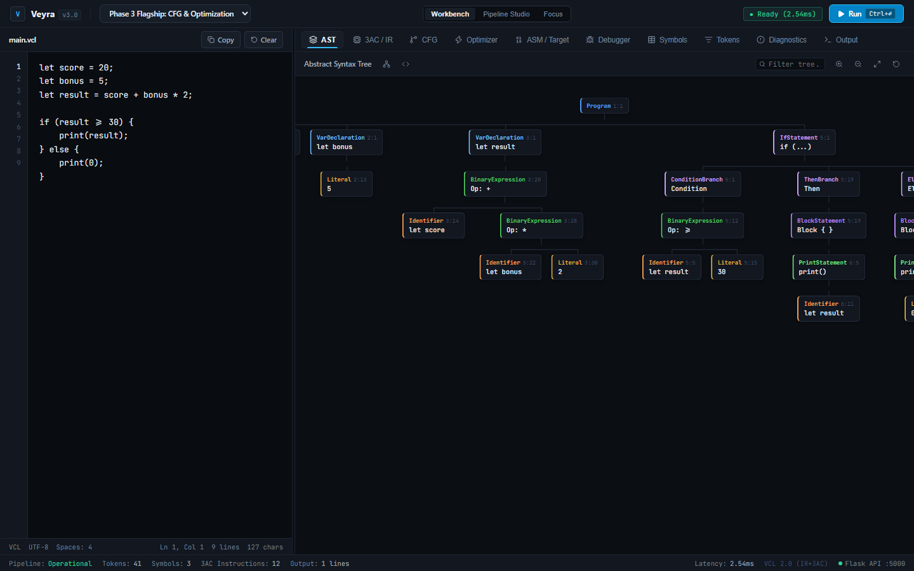
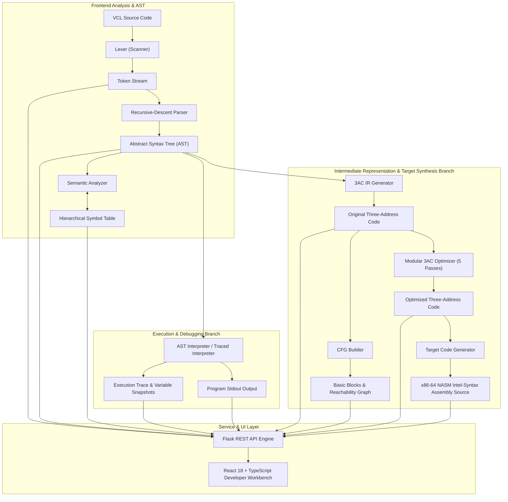
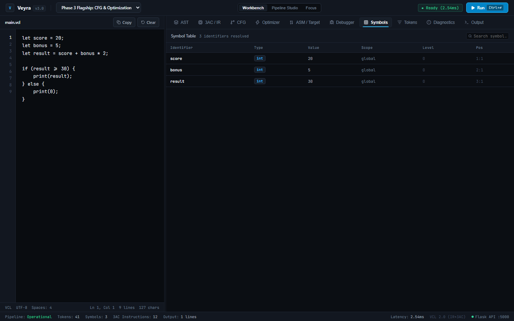
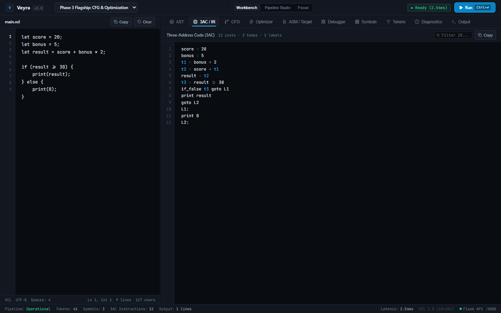
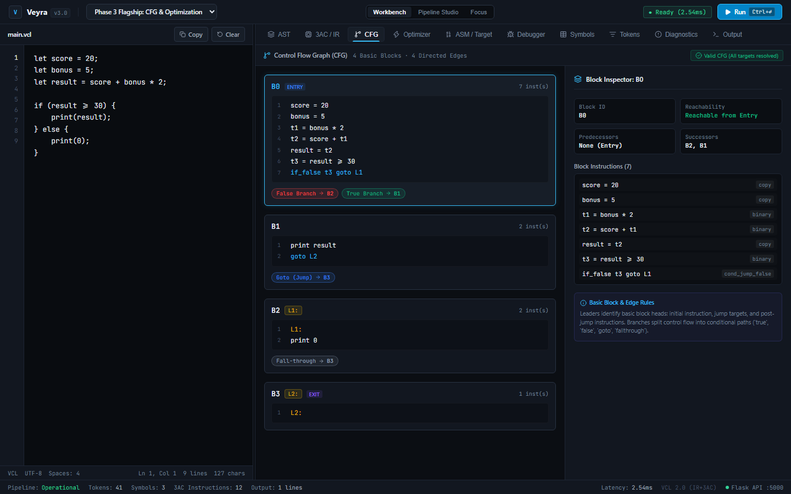
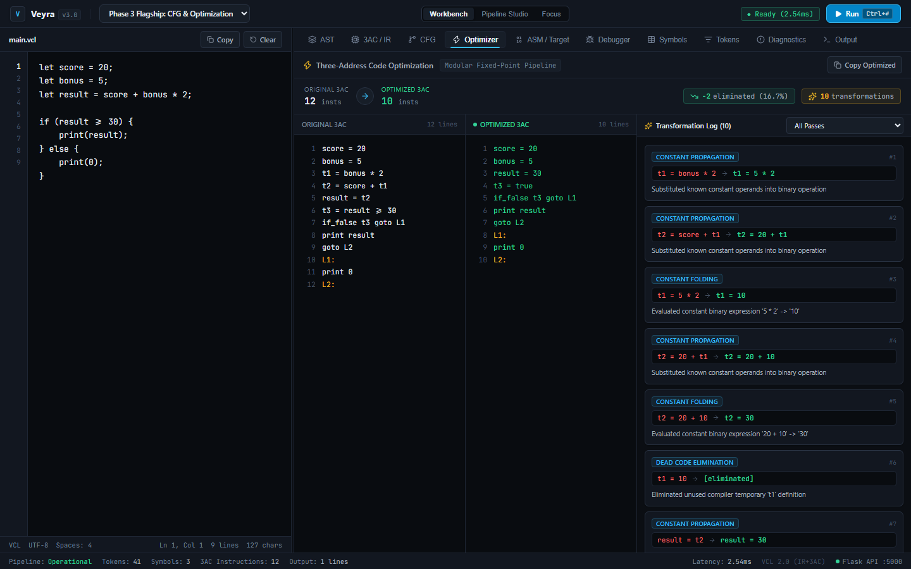
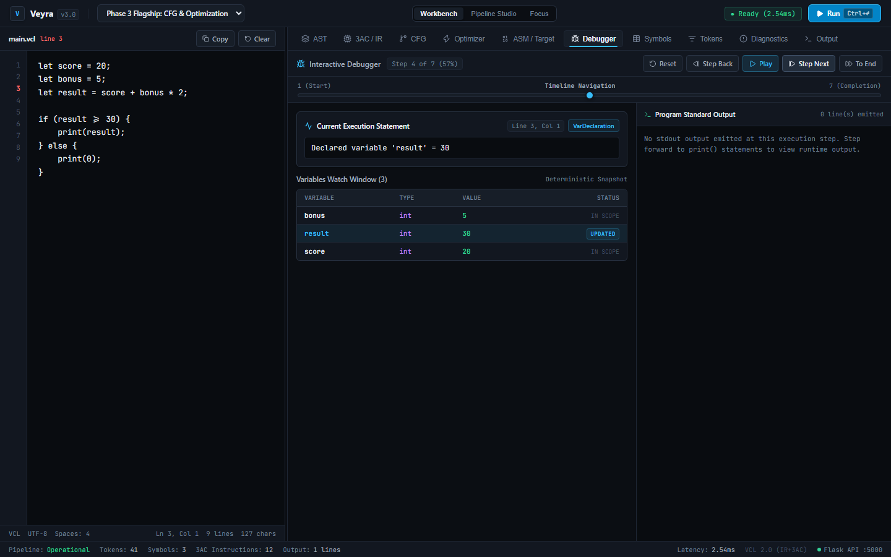
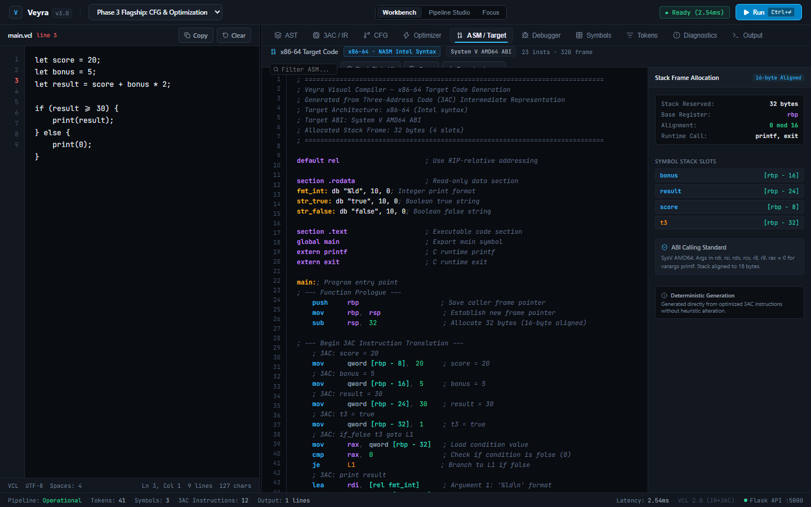
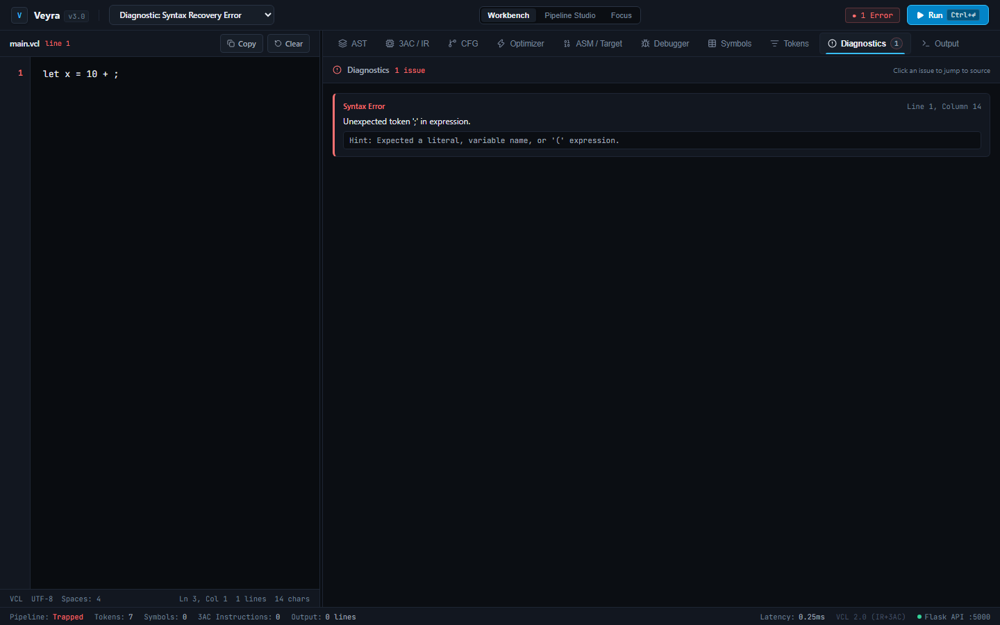
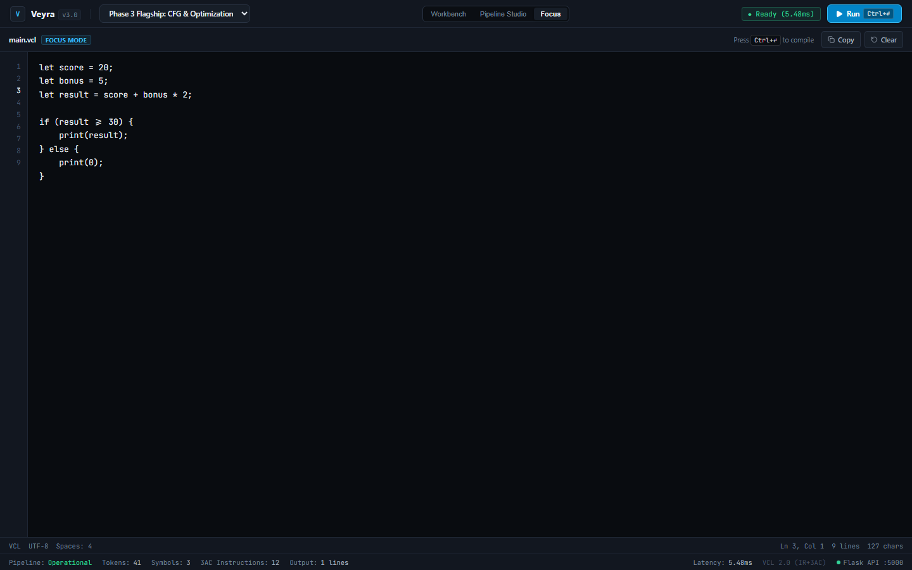

# Veyra Visual Compiler

An interactive compiler engineering environment for exploring language processing, intermediate representations, control flow, optimization, runtime tracing, and assembly generation.

[](https://www.python.org/)
[](https://flask.palletsprojects.com/)
[](https://react.dev/)
[](https://vitejs.dev/)
[](tests/)
[](LICENSE)

**Repository:** [https://github.com/Pranay-Kumar-02/veyra-visual-compiler](https://github.com/Pranay-Kumar-02/veyra-visual-compiler)

---



---

## Table of Contents

- [Why Veyra?](#why-veyra)
- [What is Veyra?](#what-is-veyra)
- [Features](#features)
- [Compiler Architecture](#compiler-architecture)
- [How Assembly Generation Works](#how-assembly-generation-works)
- [Supported VCL Language](#supported-vcl-language)
- [Screenshots and Visual Gallery](#screenshots-and-visual-gallery)
- [Technology Stack](#technology-stack)
- [Getting Started](#getting-started)
- [How to Use Veyra](#how-to-use-veyra)
- [Testing and Verification](#testing-and-verification)
- [Workflow Comparison](#workflow-comparison)
- [Limitations and Future Work](#limitations-and-future-work)
- [Project Information and Acknowledgements](#project-information-and-acknowledgements)

---

## Why Veyra?

Traditional production compilers operate as opaque translation tools: source code enters, and machine binaries or errors emerge. For students, compiler engineers, and software practitioners, the internal representations that make compilers work—token streams, recursive syntax trees, lexical scope resolutions, intermediate instructions, basic block partitions, and optimization passes—remain invisible unless manually instrumented or dumped via verbose command-line flags.

Veyra was built to solve this inspection barrier. By coupling a dedicated compiler pipeline with an analytical browser interface, Veyra exposes every intermediate data structure side by side with the input code. Users can trace how language constructs are tokenized, parsed, type-checked, linearized into intermediate code, structured into control flow graphs, simplified by optimization passes, translated into target assembly, and interpreted step by step.

---

## What is Veyra?

Veyra is an interactive compiler engineering platform centered around the **Visual Compiler Language (VCL)**, a compact educational programming language engineered for compiler pedagogy. Veyra pairs an analytical Python/Flask compiler engine with a modern React/TypeScript single-page application.

Rather than treating the compiler as an isolated CLI utility, Veyra organizes compilation into inspectable stages. Users can edit VCL code, trigger compilation, and immediately inspect:
- Structured tokens with source coordinates
- Precedence-accurate Abstract Syntax Trees (AST)
- Hierarchical Symbol Tables with lexical scoping
- Linearized Three-Address Code (3AC) with explicit temporaries
- Directed Control Flow Graphs (CFG) with basic block inspection and reachability
- A five-pass modular 3AC intermediate code optimizer with before/after comparisons
- Target x86-64 NASM Intel-syntax assembly generation with stack frame allocation
- A step-by-step runtime debugger recording discrete AST execution snapshots

---

## Features

### 1. Lexical Analysis
The scanner performs character-by-character tokenization, tracking exact 1-based line numbers, column positions, and source spans. It categorizes lexemes into keywords (`let`, `if`, `else`, `print`), identifiers, literal values, multi-character relational operators, and logical operators.

### 2. Syntax Analysis & AST Construction
A recursive-descent parser uses operator precedence climbing to enforce correct arithmetic, relational, and logical binding. It produces an immutable, strongly-typed Abstract Syntax Tree representing variable declarations, assignments, conditionals, blocks, and print statements.

### 3. Semantic Analysis
The static analyzer enforces declaration-before-use rules, verifies identifier scope visibility, prevents duplicate declarations within the same scope, validates condition expressions, and flags invalid operand types before code generation or interpretation.

### 4. Hierarchical Symbol Table
Maintains an inspectable tree of lexical scopes. Identifiers resolve through parent scope pointers, capturing identifier names, inferred data types, active values, and the exact source line and column of declaration.

### 5. Three-Address Code (3AC) Generation
The intermediate code generator linearizes the validated AST into a sequence of explicit Three-Address Code instructions. Expressions are decomposed into deterministic temporary registers (`t1`, `t2`, ...), and control flow constructs are mapped to explicit branch labels (`L1`, `L2`, ...) without mutating the underlying AST.

### 6. Control Flow Graph (CFG) Construction
The CFG builder identifies basic block leaders from 3AC instructions, partitions code into single-entry, single-exit basic blocks (`B0`, `B1`, ...), and computes directed edges with explicit classifications: unconditional jump (`goto`), conditional branch (`true` / `false`), fall-through, and loop back-edges. It runs breadth-first reachability analysis from the entry block to detect and highlight unreachable code.

### 7. Modular 3AC Optimization Pipeline
A five-pass intermediate code optimizer operates sequentially on 3AC instructions:
- **Constant Folding:** Evaluates compile-time arithmetic, relational, and boolean operations. *Safeguard: Refuses to fold division or modulo by zero to preserve runtime exception semantics.*
- **Basic-Block-Local Constant Propagation:** Propagates known constants within basic blocks, ensuring join-safety across dynamic branches without global analysis assumptions.
- **Safe Algebraic Simplification:** Applies canonical identities ($x + 0 \to x$, $x \times 1 \to x$, $x \times 0 \to 0$, $x - 0 \to x$, $x \land \text{true} \to x$, $x \lor \text{false} \to x$).
- **Dead-Code Elimination:** Prunes unused compiler-generated temporaries while strictly preserving user variables, assignments, and side-effecting operations like `print`.
- **Unreachable-Code Elimination:** Folds static conditional jumps, eliminates dead instructions following unconditional branches, removes unreferenced labels, and prunes unreachable basic blocks.

The optimizer retains the original 3AC, producing an instruction-reduction metric and an itemized transformation log.

### 8. Step-by-Step Runtime Debugger
Instruments the AST interpreter to generate an immutable sequence of discrete execution events. The debugger captures variable state snapshots, tracks variable mutations, logs conditional branch decisions (`Then` vs `Else`), records incremental stdout output, and synchronizes the active execution line with the editor in real time.

### 9. Target Assembly Code Generation (x86-64 NASM)
Translates validated, optimized 3AC into clean, readable Intel-syntax assembly compatible with the Netwide Assembler (NASM). Features deterministic base-pointer relative stack slot allocation (`[rbp - offset]`), 16-byte stack frame alignment compliant with System V AMD64 and Microsoft x64 ABIs, explicit C runtime linkage (`printf`, `exit`), and an automatic zero-divisor runtime trap (`.L_div_zero_trap`).

### 10. Structured Compiler Diagnostics
Replaces raw terminal exceptions with structured diagnostic objects. Diagnostics categorize errors by compilation stage (Lexical, Syntax, Semantic, Runtime), providing precise line and column coordinates, contextual source snippets, and actionable correction hints.

---

## Compiler Architecture

The diagram below illustrates Veyra's actual implementation pipeline. The frontend performs lexical, syntactic, and semantic validation. From the validated AST, the architecture splits into two distinct paths:
1. **Execution and Debugging:** The AST interpreter executes source semantics and records discrete runtime trace events.
2. **Intermediate Code Analysis & Target Synthesis:** The AST is converted to 3AC, analyzed via the CFG builder, transformed by the 5-pass optimizer, and emitted as x86-64 NASM assembly source.



> [!NOTE]
> - The Control Flow Graph (CFG) provides structural analysis and visualization of 3AC basic blocks; it does not directly execute target instructions.
> - The AST Interpreter and the 3AC Target Generation pipeline are distinct branches: execution results and debug traces come from the AST runtime engine, while assembly generation emits target source code for toolchain inspection.

---

## How Assembly Generation Works

Target code generation bridges the gap between machine-independent intermediate code and concrete processor instructions. Veyra's generator (`backend/codegen.py`) translates Three-Address Code into readable, correct x86-64 assembly in Intel syntax.

### Translation Pipeline

1. **Stack Frame Sizing:** The generator scans all 3AC instructions to collect every distinct user identifier and compiler-generated temporary. Each is assigned a deterministic 8-byte (64-bit quadword) stack slot relative to the base pointer (`[rbp - 8]`, `[rbp - 16]`, etc.).
2. **16-Byte Frame Alignment:** The total stack allocation is padded to a multiple of 16 bytes to satisfy x86-64 ABI function calling conventions before invoking external runtime routines. On Windows targets (`win64`), 32 bytes of shadow store space are included.
3. **Prologue Emission:** Emits standard 64-bit function entry:
   ```nasm
   push rbp
   mov  rbp, rsp
   sub  rsp, <frame_size>
   ```
4. **Instruction Lowering:** Maps individual 3AC operations to x86-64 Intel-syntax instructions:
   - **Data Movement (`CopyInstruction`):** Emits `mov` from immediate literals or memory slots through registers (`rax`).
   - **Arithmetic (`BinaryOpInstruction`):** Maps `+` to `add`, `-` to `sub`, `*` to `imul`, and `/` / `%` to signed `idiv` with quadword sign extension (`cqo`).
   - **Relational Comparisons:** Performs `cmp` followed by condition set byte instructions (`sete`, `setne`, `setl`, `setle`, `setg`, `setge`) and `movzx` zero extension.
   - **Logical Operations:** Emits bitwise `and`, `or`, and `not` instructions for boolean logic.
   - **Branching & Labels (`JumpInstruction`, `JumpIfFalseInstruction`, `LabelInstruction`):** Translates conditional jumps to test comparisons (`cmp rax, 0`) followed by `je` (jump if false) or `jne` (jump if true), and emits target labels directly.
   - **Standard Output (`PrintInstruction`):** Loads format strings (`fmt_int`, `str_true`, `str_false`) and passes arguments through designated ABI registers (`rdi`/`rsi` for System V; `rcx`/`rdx` for Windows x64) before calling `printf`.
   - **Zero-Divisor Runtime Guard:** If division or modulo instructions are present, emits a test-and-jump guard to `.L_div_zero_trap`, which prints a runtime error message and invokes `exit(1)`.
5. **Epilogue Emission:** Emits standard procedure teardown:
   ```nasm
   xor eax, eax
   mov rsp, rbp
   pop rbp
   ret
   ```

### Real Lowering Example

Given the following VCL source:

```vcl
let score = 20;
let bonus = 5;
let result = score + bonus * 2;

if (result >= 30) {
    print(result);
} else {
    print(0);
}
```

The intermediate generator produces original 3AC:

```text
  score = 20
  bonus = 5
  t1 = bonus * 2
  t2 = score + t1
  result = t2
  t3 = result >= 30
  if_false t3 goto L1
  print result
  goto L2
L1:
  print 0
L2:
```

The 3AC optimizer propagates constants, folds arithmetic, and prunes dead temporaries `t1` and `t2`:

```text
  score = 20
  bonus = 5
  result = 30
  t3 = true
  if_false t3 goto L1
  print result
  goto L2
L1:
  print 0
L2:
```

The assembly generator allocates 32 bytes on the stack (4 quadword slots) and lowers the optimized 3AC into NASM-compatible assembly:

```nasm
default rel
section .rodata
fmt_int: db "%ld", 10, 0
str_true: db "true", 10, 0
str_false: db "false", 10, 0

section .text
global main
extern printf
extern exit

main:
    push     rbp
    mov      rbp, rsp
    sub      rsp, 32

    ; 3AC: score = 20
    mov      qword [rbp - 8], 20
    ; 3AC: bonus = 5
    mov      qword [rbp - 16], 5
    ; 3AC: result = 30
    mov      qword [rbp - 24], 30
    ; 3AC: t3 = true
    mov      qword [rbp - 32], 1

    ; 3AC: if_false t3 goto L1
    mov      rax, qword [rbp - 32]
    cmp      rax, 0
    je       L1

    ; 3AC: print result
    lea      rdi, [rel fmt_int]
    mov      rsi, qword [rbp - 24]
    xor      eax, eax
    call     printf
    jmp      L2

L1:
    ; 3AC: print 0
    lea      rdi, [rel fmt_int]
    mov      rsi, 0
    xor      eax, eax
    call     printf

L2:
.L_exit_normal:
    xor      eax, eax
    mov      rsp, rbp
    pop      rbp
    ret
```

> [!IMPORTANT]
> **Assembly Source vs. Raw Binary Execution:**
> Veyra generates standard, inspectable `.asm` assembly source code. Assembling it into an ELF/Mach-O/PE object file and linking it with the C standard library requires external tools (such as `nasm` and `gcc`/`clang`). In the web workspace, interactive program execution and variable snapshots are powered by the verified AST interpreter.

---

## Supported VCL Language

Visual Compiler Language (VCL) is a statically analyzed language designed for compiler education.

### Formal Grammar (EBNF)

```ebnf
Program         ::= Statement* EOF
Statement       ::= VarDeclaration | Assignment | PrintStatement | IfStatement | BlockStatement

VarDeclaration  ::= "let" IDENTIFIER "=" Expression ";"
Assignment      ::= IDENTIFIER "=" Expression ";"
PrintStatement  ::= "print" "(" Expression ")" ";"
IfStatement     ::= "if" "(" Expression ")" Statement ( "else" Statement )?
BlockStatement  ::= "{" Statement* "}"

Expression      ::= LogicalOr
LogicalOr       ::= LogicalAnd ( "||" LogicalAnd )*
LogicalAnd      ::= Equality ( "&&" Equality )*
Equality        ::= Relational ( ( "==" | "!=" ) Relational )*
Relational      ::= Additive ( ( "<" | ">" | "<=" | ">=" ) Additive )*
Additive        ::= Multiplicative ( ( "+" | "-" ) Multiplicative )*
Multiplicative  ::= Unary ( ( "*" | "/" | "%" ) Unary )*
Unary           ::= ( "-" | "!" ) Unary | Primary
Primary         ::= INTEGER | FLOAT | BOOLEAN | IDENTIFIER | "(" Expression ")"
```

### Language Constructs & Data Types

| Construct | Syntax | Example | Notes |
| :--- | :--- | :--- | :--- |
| **Variables** | `let <id> = <expr>;` | `let score = 20;` | Block-scoped declaration. |
| **Assignment** | `<id> = <expr>;` | `score = score + 5;` | Requires prior declaration in visible scope. |
| **Integers** | Digits | `42`, `-10` | 64-bit signed representation. |
| **Floats** | Decimal point | `3.14159` | Supported in lexer, parser, and interpreter. |
| **Booleans** | `true` \| `false` | `true`, `false` | Conditionals require boolean expressions. |
| **Arithmetic** | `+`, `-`, `*`, `/`, `%` | `a + b * c` | Standard algebraic precedence. |
| **Relational** | `==`, `!=`, `<`, `<=`, `>`, `>=` | `result >= 30` | Produces boolean evaluation. |
| **Logical** | `&&`, `\|\|`, `!` | `x > 0 && !flag` | Logical AND, OR, and NOT. |
| **Conditionals** | `if (...) { ... } else { ... }` | See sample | `else` clause is optional. |
| **Blocks** | `{ ... }` | `{ let local = 1; }` | Establishes a nested lexical scope. |
| **Print** | `print(<expr>);` | `print(result);` | Emits output to standard output buffer. |

> [!NOTE]
> **Current Language Scope:**
> VCL focuses strictly on core procedural compiler concepts. Loops (`while`, `for`) and user-defined functions are deliberately not part of the current grammar.

### Valid Sample Program

```vcl
let score = 20;
let bonus = 5;
let result = score + bonus * 2;

if (result >= 30) {
    print(result);
} else {
    print(0);
}
```

**Expected AST Interpreter Output:**
```text
30
```

---

## Screenshots and Visual Gallery

All images represent genuine captures of the running Veyra workspace in Google Chrome:

| View | Screenshot | Description |
| :--- | :---: | :--- |
| **1. Integrated Workspace** |  | Unified dark-theme workbench displaying code editor, AST visualization, telemetry metrics, and compilation status. |
| **2. AST Visualizer** |  | Expandable, color-coded Abstract Syntax Tree hierarchy with operator precedence and node source coordinates. |
| **3. Symbol Table** |  | Lexical scope inspector displaying identifier bindings, inferred types, runtime values, and declaration lines. |
| **4. Three-Address Code** |  | Linearized 3AC instruction sequence showing explicit compiler temporaries (`t1`, `t2`, ...) and branch labels. |
| **5. Control Flow Graph** |  | Basic block decomposition (`B0`–`B3`) with directed edges (`True`, `False`, `Goto`) and reachability indicators. |
| **6. 3AC Optimization** |  | Side-by-side original vs. optimized 3AC comparison, reduction statistics, and itemized transformation log. |
| **7. Step-by-Step Debugger** |  | Interactive execution debugger with timeline scrubber, live variable snapshot watch, and line synchronization. |
| **8. Target Assembly (ASM)** |  | x86-64 NASM Intel-syntax assembly viewer with stack slot drawer, copy-to-clipboard, and `.asm` download. |
| **9. Diagnostics & Errors** |  | Stage-tagged diagnostic card showing syntax recovery at Line 1 Column 14 with code context and actionable hint. |
| **10. Focus Mode Editor** |  | Distraction-free full-width code editing environment with status bar telemetry and compilation shortcuts. |

---

## Technology Stack

### Backend
- **Python 3.12:** Core language for lexer, parser, semantic analyzer, 3AC generator, CFG builder, optimizer, ASM generator, and interpreter.
- **Flask 3.1:** Lightweight WSGI application server exposing REST endpoints (`/api/compile`, `/api/cfg`, `/api/optimize`, `/api/codegen`, `/api/debug`).
- **pytest 9.1:** Automated test runner for unit, integration, and API validation.

### Frontend
- **React 18:** Component architecture for interactive workbench panels.
- **TypeScript 5:** Static type safety across compiler artifact models.
- **Vite 5:** Modern build tool and development server for fast HMR.
- **Lucide React:** Iconography for workbench panels and status telemetry.

### Verification & Tooling
- **Playwright:** Automated headless browser screenshot capture and viewport testing.

---

## Getting Started

### Prerequisites
- **Python 3.10+** (tested with Python 3.12.5)
- **Node.js 18+** with `npm` (tested with Node v22 and npm 10.9)
- **Git**

### Installation & Local Run

#### 1. Clone the Repository
```bash
git clone https://github.com/Pranay-Kumar-02/veyra-visual-compiler.git
cd veyra-visual-compiler
```

#### 2. Backend Setup
```powershell
# Windows PowerShell
python -m venv venv
.\venv\Scripts\Activate.ps1
pip install -r requirements.txt
python app.py
```

```bash
# macOS / Linux
python3 -m venv venv
source venv/bin/activate
pip install -r requirements.txt
python3 app.py
```

The Flask server will start at **`http://127.0.0.1:5000`** and serve both the REST API and the pre-built frontend bundle.

#### 3. Frontend Development (Optional)
If modifying UI components, run the Vite development server with Hot Module Replacement:
```bash
cd frontend
npm install
npm run dev
```

To build a fresh production frontend bundle:
```bash
cd frontend
npm run build
```

---

## How to Use Veyra

1. **Launch Workspace:** Start the application and open `http://127.0.0.1:5000` in your web browser.
2. **Select or Write Code:** Choose a preset from the navbar dropdown (e.g., *Phase 3 Flagship*) or write custom VCL code in the editor.
3. **Compile Source:** Click **Run** or press `Ctrl + Enter` to trigger full pipeline analysis.
4. **Inspect Tokens & AST:** Switch to **Tokens** to review lexemes and coordinates, or **AST** to explore the syntax tree hierarchy.
5. **Inspect Symbols:** Open **Symbols** to examine variable scopes, types, values, and declaration locations.
6. **Review Intermediate Code:** Navigate to **3AC / IR** to see linearized three-address instructions with compiler temporaries.
7. **Analyze Control Flow:** Open **CFG** to inspect basic blocks, branch conditions, fall-through paths, and block reachability.
8. **Evaluate Optimizations:** Switch to **Optimizer** to observe constant folding, propagation, algebraic simplification, and temporary elimination.
9. **Inspect Target Assembly:** Open **ASM / Target** to inspect generated x86-64 NASM Intel-syntax assembly and the stack frame layout.
10. **Step Through Execution:** Open **Debugger** and use **Step Next** or the timeline scrubber to watch variable mutations and branch decisions in real time.

---

## Testing and Verification

Veyra includes an automated test suite of **100 tests** covering every stage of the compiler pipeline:

```bash
# Run full automated test suite
python -m pytest tests -v
```

### Verified Test Suite Breakdown

```text
============================= test session starts =============================
platform win32 -- Python 3.12.5, pytest-9.1.1, pluggy-1.6.0
rootdir: C:\Users\PRANAY KUMAR\OneDrive\Desktop\veyra-visual-compiler
collected 100 items

tests\test_api_and_phase3.py .........                                   [  9%]
tests\test_cfg.py .......                                                [ 16%]
tests\test_codegen.py ...........                                        [ 27%]
tests\test_debugger.py .....                                             [ 32%]
tests\test_integration.py ..............                                 [ 46%]
tests\test_interpreter.py ........                                       [ 54%]
tests\test_ir.py ............                                            [ 66%]
tests\test_lexer.py .........                                            [ 75%]
tests\test_optimizer.py ..........                                       [ 85%]
tests\test_parser.py ........                                            [ 93%]
tests\test_semantic.py .......                                           [100%]

============================ 100 passed in 1.15s ==============================
```

### Frontend Build Verification

```bash
cd frontend && npm run build
```

```text
> veyra-frontend@2.0.0 build
> tsc && vite build

vite v5.4.21 building for production...
✓ 1930 modules transformed.
dist/index.html                   0.96 kB │ gzip:  0.53 kB
dist/assets/index-C9sRizwF.css   22.72 kB │ gzip:  4.19 kB
dist/assets/index-BQxu-aE2.js   250.34 kB │ gzip: 68.64 kB
✓ built in 14.11s
```

---

## Workflow Comparison

The table below contrasts a standard compiler learning exercise with Veyra's interactive workflow:

| Pipeline Stage | Typical Isolated Exercise | Veyra Interactive Workflow |
| :--- | :--- | :--- |
| **Pipeline Visibility** | Source code input produces only a binary or terminal message | Real-time inspection of tokens, AST, symbols, 3AC, CFG, optimized IR, and ASM |
| **Syntax Analysis** | Static text dumps of AST nodes | Interactive, expandable tree visualizer linked to source editor locations |
| **Scope Resolution** | Text printouts or debugger dumps | Hierarchical symbol table detailing scope depth, types, and values |
| **Intermediate Code** | Unconnected IR listing printed to stdout | Linear 3AC synchronized with basic block partitions and optimization passes |
| **Control Flow** | Manually drawn graph diagrams | Automated basic block leader discovery, directed edge categorization, and reachability |
| **Optimization** | Theoretical descriptions of folding and propagation | Live before/after diffs, reduction metrics, and per-instruction transformation logs |
| **Target Synthesis** | Disconnected backend or simulator | Direct lowering of optimized 3AC to x86-64 NASM assembly with stack slot mappings |
| **Runtime Debugging** | Print statements or generic gdb/lldb inspection | Discrete AST execution timeline scrubbing with variable watch and branch callouts |

---

## Limitations and Future Work

While Veyra provides an end-to-end compiler engineering experience, the following technical boundaries are intentionally maintained:

- **Grammar Scope:** VCL currently implements procedural declarations, assignments, arithmetic/logical expressions, and conditionals. Loops (`while`, `for`) and user-defined functions are not part of the grammar.
- **Optimization Scope:** Constant propagation operates within basic blocks to guarantee join safety across branches without full SSA (Static Single Assignment) form.
- **Assembly Execution:** The target code generator emits valid x86-64 NASM Intel-syntax assembly source. Assembling into machine binaries requires external host toolchains (`nasm` + `gcc`/`clang`); within the workspace, program execution is provided by the verified AST interpreter.
- **Register Allocation:** Target code generation utilizes a base-pointer stack storage model (`[rbp - offset]`) with scratch register lowerings rather than graph-coloring register allocation.

### Planned Enhancements
- SSA Form (Static Single Assignment) with dominance frontiers
- Global value numbering (GVN) and common subexpression elimination (CSE)
- Register allocation via Chaitin-Briggs graph coloring
- While-loop control flow constructs and loop-invariant code motion (LICM)

---

## Project Information and Acknowledgements

- **Student:** VONAMALA PRANAY KUMAR
- **Course:** BCSE307P — Compiler Design Laboratory
- **Institution:** Vellore Institute of Technology, Vellore
- **GitHub Repository:** [https://github.com/Pranay-Kumar-02/veyra-visual-compiler](https://github.com/Pranay-Kumar-02/veyra-visual-compiler)
- **License:** [MIT License](LICENSE)

### References & Core Influences
- Alfred V. Aho, Monica S. Lam, Ravi Sethi, Jeffrey D. Ullman — *Compilers: Principles, Techniques, and Tools* (Dragon Book)
- Keith D. Cooper, Linda Torczon — *Engineering a Compiler*
- NASM: The Netwide Assembler Official Documentation & Intel 64 and IA-32 Architectures Software Developer’s Manuals
- System V Application Binary Interface: AMD64 Architecture Processor Supplement
