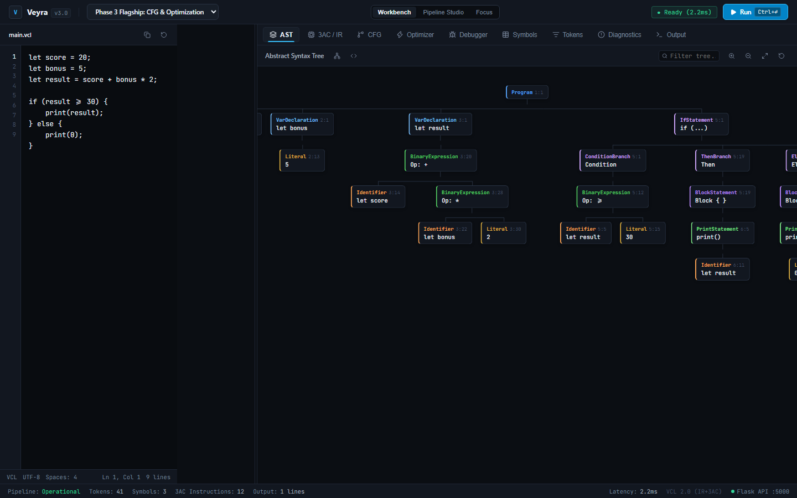
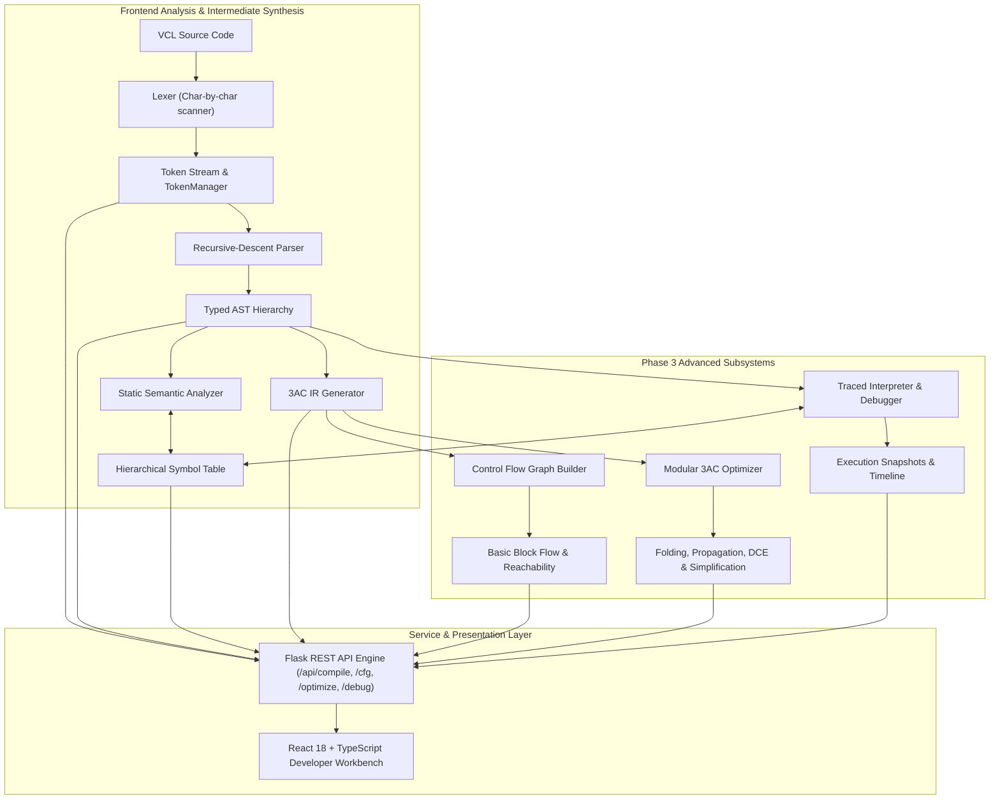

# Veyra Visual Compiler

An interactive compiler engineering environment that makes the language-processing pipeline observable, inspectable, and executable.

<p align="center">
  <strong>VCL</strong> &bull;
  <strong>AST Visualization</strong> &bull;
  <strong>Symbol Table</strong> &bull;
  <strong>Three-Address Code (3AC)</strong> &bull;
  <strong>Control Flow Graph (CFG)</strong> &bull;
  <strong>3AC Optimization</strong> &bull;
  <strong>Step-by-Step Debugger</strong>
</p>

<p align="center">
  <a href="https://www.python.org/"></a>
  <a href="https://flask.palletsprojects.com/"></a>
  <a href="https://react.dev/"></a>
  <a href="tests/"></a>
  <a href="LICENSE"></a>
</p>

---

## Workspace Overview



---

## 1. Project Philosophy & Core Purpose

Traditional compilers operate as opaque black boxes:

$$\text{Source Code} \longrightarrow \fbox{Compiler} \longrightarrow \text{Machine Output}$$

For computer science students, compiler engineers, and software architects, this opaque paradigm hides the most critical transformations:
1. How character streams are converted into structured tokens.
2. How grammar rules enforce precedence and build typed Abstract Syntax Trees (ASTs).
3. How lexical scopes resolve identifier bindings in a Symbol Table.
4. How AST statements are linearized into Three-Address Code (3AC) with explicit temporaries and jump targets.
5. How basic blocks form a directed Control Flow Graph (CFG) with branch and fall-through edges.
6. How classical compiler optimizations (constant folding, copy propagation, algebraic simplification, dead code elimination) transform intermediate code safely.
7. How the execution runtime steps through code, tracks variable updates, and traps exceptions.

**Veyra Visual Compiler** solves this by making the entire compiler pipeline transparent, inspectable, and interactive:

$$\text{Source} \to \text{Tokens} \to \text{AST} \to \text{Semantics} \to \text{Symbol Table} \to \text{3AC (IR)} \to \text{CFG} \to \text{Optimization} \to \text{Traced Debugger} \to \text{Output}$$

---

## 2. Compiler Pipeline Architecture



---

## 3. Implemented Capabilities by Milestone

### Phase 1: Core Compiler Fundamentals
- **Lexical Analysis (`backend/lexer.py`):** Character-by-character scanner tracking exact line and column coordinates, with support for keywords, integer/float/boolean literals, relational operators, and logical operators.
- **Recursive-Descent Parser (`backend/parser.py`):** Precedence-climbing syntactic parser constructing a typed, immutable AST.
- **Hierarchical Symbol Table (`backend/symbol_table.py`):** Lexical scope hierarchy with parent-pointer resolution, type inference, and value binding.
- **Static Semantic Analysis (`backend/semantic.py`):** Multi-pass validation checking for undeclared identifiers, scope isolation, and duplicate declarations.
- **AST Tree-Walking Interpreter (`backend/interpreter.py`):** Genuine AST evaluator with runtime environment stack, division/modulo-by-zero traps, and standard output buffering.

### Phase 2: Intermediate Representation (3AC)
- **Programmatic IR Generator (`backend/ir.py`):** Translates validated AST into linear Three-Address Code with explicit compiler-generated temporaries (`t1`, `t2`, ...) and branch labels (`L1`, `L2`, ...).
- **Structured 3AC Instructions:** Strongly-typed representation for `CopyInstruction`, `BinaryOpInstruction`, `UnaryOpInstruction`, `LabelInstruction`, `JumpInstruction`, `JumpIfFalseInstruction`, `JumpIfTrueInstruction`, and `PrintInstruction`.
- **AST Immutability:** IR emission guarantees strict non-mutation of the original Abstract Syntax Tree.

### Phase 3: Advanced Systems & Final Deliverables
- **Control Flow Graph (CFG) Engine (`backend/cfg.py`):**
  - Canonical 3-rule basic block leader identification.
  - Basic block construction and sequential instruction partitioning.
  - Precise directed edge resolution: conditional taken (`true`/`false`), unconditional (`goto`), fall-through, and loop back-edges.
  - Entry-block identification and BFS reachability analysis to detect dead/unreachable blocks.
  - Undefined jump target validation.
- **Modular Intermediate-Code Optimization Pipeline (`backend/optimizer.py`):**
  - **Constant Folding:** Compile-time arithmetic, relational, and logical evaluation. *Preserves runtime error behavior by refusing to fold division or modulo by zero.*
  - **Constant Propagation:** Basic block-scoped value substitution ensuring join-safety across dynamic branches.
  - **Safe Algebraic Simplification:** Mathematical identities ($x+0, x\times 1, x\times 0, x/1, x\land \text{true}, x\lor \text{false}$).
  - **Dead-Code Elimination:** Prunes unused compiler temporaries without deleting side-effects or user variables.
  - **Unreachable-Code Elimination:** Folds static conditional jumps, removes code following unconditional jumps, prunes unreferenced labels, and eliminates unreachable basic blocks.
  - **Post-Optimization Validation:** Verifies that all remaining branch targets exist in the optimized label table.
- **Step-by-Step Runtime Debugger (`backend/debugger.py`):**
  - Instruments the AST interpreter to record discrete execution events.
  - Maintains immutable snapshots of visible variables, modified variables, branch decisions (`Then` vs `Else`), and accumulated stdout.
  - **Deterministic navigation:** Forward, backward, and reset scrubbing operates on recorded snapshots and never reruns side-effects.
  - Synchronizes active statement execution with the code editor line highlighter.

---

## 4. Visual Evidence Gallery

All screenshots represent real compiler outputs captured from the running instance:

| Artifact | Preview | Description |
| :--- | :---: | :--- |
| **Integrated Workspace** | [View Screenshot](docs/assets/01_integrated_workspace.png) | Dark IDE workspace with code editor, AST tree visualizer, telemetry bar, and Review 3 tabs. |
| **Control Flow Graph** | [View Screenshot](docs/assets/02_cfg_visualization.png) | Partitioned basic blocks (`B0`–`B3`), edge labels (`True`, `False`, `Goto`), and interactive Block Inspector. |
| **3AC Optimization** | [View Screenshot](docs/assets/03_original_vs_optimized_3ac.png) | Side-by-side original vs optimized 3AC diff, reduction metrics, and transformation rule log. |
| **Step-by-Step Debugger** | [View Screenshot](docs/assets/04_step_debugger.png) | Live variables watch window, line highlight synchronization, branch decision callout, and timeline scrubber. |
| **Diagnostics & Error Trapping** | [View Screenshot](docs/assets/05_invalid_input_diagnostic.png) | Structured syntax error reporting at Line 1, Column 14 with recovery guidance and line markers. |
| **Linear 3AC Stream** | [View Screenshot](docs/assets/06_three_address_code.png) | Linearized 3AC instructions with explicit temporaries and jump labels. |
| **Automated Test Results** | [View Screenshot](docs/assets/07_test_results.png) | Terminal execution showing 89 passing automated tests with 100% pass rate. |

---

## 5. Visual Compiler Language (VCL) Specification

VCL is a statically analyzed, dynamically typed language engineered for compiler pedagogy:

```ebnf
Program         ::= Statement* EOF
Statement       ::= VarDeclaration | Assignment | PrintStatement | IfStatement | BlockStatement
VarDeclaration  ::= "let" IDENTIFIER "=" Expression ";"
Assignment      ::= IDENTIFIER "=" Expression ";"
PrintStatement  ::= "print" "(" Expression ")" ";"
IfStatement     ::= "if" "(" Expression ")" Statement ( "else" Statement )?
BlockStatement  ::= "{" Statement* "}"

Expression      ::= LogicalOr
LogicalOr       ::= LogicalAnd ( "||" LogicalAnd )*
LogicalAnd      ::= Equality ( "&&" Equality )*
Equality        ::= Relational ( ( "==" | "!=" ) Relational )*
Relational      ::= Additive ( ( "<" | ">" | "<=" | ">=" ) Additive )*
Additive        ::= Multiplicative ( ( "+" | "-" ) Multiplicative )*
Multiplicative  ::= Unary ( ( "*" | "/" | "%" ) Unary )*
Unary           ::= ( "-" | "!" ) Unary | Primary
Primary         ::= INTEGER | FLOAT | BOOLEAN | IDENTIFIER | "(" Expression ")"
```

### Representative Benchmark Program (`examples/phase2_demo.vcl`)
```vcl
let score = 20;
let bonus = 5;
let result = score + bonus * 2;

if (result >= 30) {
    print(result);
} else {
    print(0);
}
```

- **Output:** `30`
- **Linear 3AC Generated:** 12 instructions
- **Optimized 3AC:** 10 instructions (2 dead temporaries eliminated, constants propagated and folded)
- **CFG Generated:** 4 basic blocks, 4 directed edges (`True`, `False`, `Goto`, `Fallthrough`)
- **Debugger Trace:** 7 discrete execution steps with variable history

---

## 6. REST API Endpoints

The Flask backend exposes modular, hardened REST endpoints:

| Endpoint | Method | Payload | Description |
| :--- | :---: | :--- | :--- |
| `/api/compile` | `POST` | `{"source": "..."}` | Complete compiler pipeline returning tokens, AST, symbols, 3AC, CFG, optimized IR, debug trace, and diagnostics. |
| `/api/cfg` | `POST` | `{"source": "..."}` | Returns basic blocks, edges, reachability status, and target validation. |
| `/api/optimize` | `POST` | `{"source": "..."}` | Returns original vs optimized 3AC and detailed transformation records. |
| `/api/debug` | `POST` | `{"source": "..."}` | Returns discrete execution event sequence with variable snapshots. |
| `/api/examples` | `GET` | _None_ | Safely lists curated `.vcl` example programs. |
| `/api/health` | `GET` | _None_ | System status, version info, and security metadata. |

### Security Hardening
- **Payload Limits:** Maximum source code size enforced at 100 KB (`MAX_SOURCE_LENGTH = 100_000`) returning HTTP 413 on oversized payloads.
- **Path Traversal Protection:** Example file retrieval strictly validates filenames using regex `^[a-zA-Z0-9_\-]+\.vcl$`.
- **Security Headers:** All responses include `X-Content-Type-Options: nosniff`, `X-Frame-Options: DENY`, `X-XSS-Protection: 1; mode=block`, and `Referrer-Policy: strict-origin-when-cross-origin`.
- **Stack Trace Isolation:** Internal errors return structured JSON diagnostic objects rather than raw Werkzeug tracebacks.

---

## 7. Quick Start & Developer Instructions

### Prerequisites
- Python 3.10+ (tested on Python 3.12.5)
- Node.js 18+ (tested with npm 10+)

### 1. Launch the Application
```bash
# Clone the repository
git clone https://github.com/Pranay-Kumar-02/veyra-visual-compiler.git
cd veyra-visual-compiler

# Install backend dependencies
pip install -r requirements.txt

# Start the Flask backend server (serves API and compiled frontend assets)
python app.py
```
Open your browser to: **`http://127.0.0.1:5000`**

### 2. Frontend Development (Optional)
```bash
cd frontend
npm install
npm run build   # Compiles production TypeScript bundle to frontend/dist/
npm run dev     # Starts Vite development server for live HMR
```

### 3. Run Automated Tests
```bash
# Run full automated test suite (89 test cases)
python -m pytest -v

# Run specific feature test suites
python -m pytest tests/test_cfg.py -v
python -m pytest tests/test_optimizer.py -v
python -m pytest tests/test_debugger.py -v
python -m pytest tests/test_api_and_phase3.py -v
python -m pytest tests/test_integration.py -v
```

---

## 8. Automated Test Suite Breakdown

All 89 automated tests pass with 100% success rate:

```
============================= test session starts =============================
platform win32 -- Python 3.12.5, pytest-8.3.5, pluggy-1.6.0
rootdir: C:\Users\PRANAY KUMAR\OneDrive\Desktop\veyra-visual-compiler
collected 89 items

tests\test_api_and_phase3.py .........                                   [ 10%]
tests\test_cfg.py .......                                                [ 17%]
tests\test_debugger.py .....                                             [ 23%]
tests\test_integration.py ..............                                 [ 39%]
tests\test_interpreter.py ........                                       [ 48%]
tests\test_ir.py ............                                            [ 61%]
tests\test_lexer.py .........                                            [ 71%]
tests\test_optimizer.py ..........                                       [ 83%]
tests\test_parser.py ........                                            [ 92%]
tests\test_semantic.py .......                                           [100%]

============================= 89 passed in 1.04s ==============================
```

---

## 9. Academic Course Attribution

- **Course:** BCSE307P — Compiler Design Laboratory
- **Author:** Pranay Kumar
- **Repository:** [https://github.com/Pranay-Kumar-02/veyra-visual-compiler](https://github.com/Pranay-Kumar-02/veyra-visual-compiler)
- **License:** [MIT License](LICENSE)
